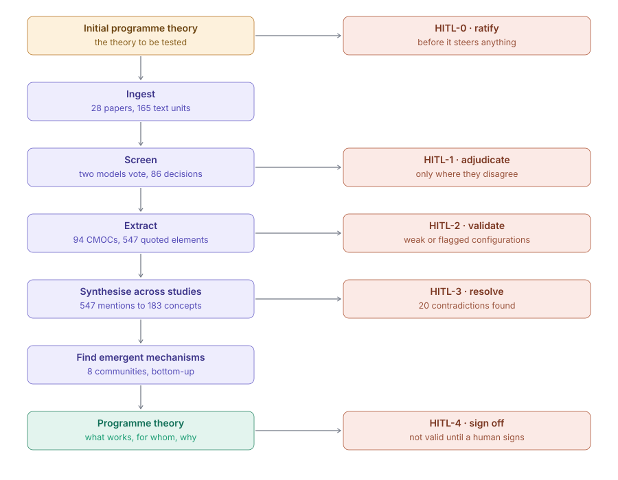

# What we built, and where everything is

**Duy Nguyen — 13 November 2026.** Deliverable 1 of the 2026-10-30 assignment.

This answers your first request: organise and provide everything developed for the Richmond
benchmark. It assumes no familiarity with the system.

---

## 0. Where we are right now

**Stage: the Richmond benchmark is complete and verified; the new topic is configured but has not
been run.** In the terms of your assignment, your section 1 and 2 are done — this document and the
next are those — and sections 3 to 6 need a corpus run, which needs API budget the project does
not have.

| | |
|---|---|
| Richmond benchmark | **Complete.** Ran end to end twice; 28 papers, 94 configurations, 547 quoted elements, verified against your benchmark |
| The five review checkpoints | **Performed, awaiting a human countersignature.** All 20 contradictions resolved and the programme theory signed, recorded as AI-performed under your section 5 delegation |
| New topic configuration | **Drafted, not reviewed.** `config-emotion/` holds the review protocol, the initial programme theory built from your four references, and rewritten agent personas |
| New topic corpus | **Not started.** The search tool works and was trialled; no corpus has been collected |
| Conference paper | **Accepted to AERA 2027** on 6 November. Reviewer comments not yet read |

**What changed in the two weeks since your email**, all of it preparation rather than new-topic
work: the pipeline gained a literature search it never had; the prompts were lifted out of the
source code into configuration; and three tests of the system's own reasoning were built, which
changed what we are entitled to claim. Those are in the progress report.

---

## 1. What the system does

A realist review asks what works, **for whom, in what circumstances, and why**. Its unit of
analysis is the Context–Mechanism–Outcome Configuration: *in this context, this resource triggers
this response, producing this outcome*. Building those by hand across dozens of papers takes a
team months, and afterwards the reasoning is hard to audit because it lives in reviewers' notes.

The pipeline does the mechanical part of that work and keeps a record of the reasoning. Six
stages, with the five points at which it stops and asks a person:




| Stage | What it does | On Richmond's 28 papers |
|---|---|---|
| Ingest | Extract text from each PDF | 28 papers, 165 text units |
| Screen | Two models vote on eligibility; disagreements go to a human | 86 decisions |
| Extract | Pull out configurations, **each element tied to a verbatim quote** | 94 CMOCs, 547 quoted elements, 459 typed relations |
| Consolidate | Collapse repeated mentions into shared concepts | 547 mentions → 183 concepts |
| Find patterns | Detect recurring configurations and contradictions | 32 recurring patterns, 20 contradictions |
| Compose | Write the programme theory | 9 context-based sections |

**The one design decision that matters most.** Every element the system extracts carries the exact
sentence it came from and that sentence's character position in the source paper. A claim without
a quote cannot enter the graph. One row, as stored:

```
study_id        S018
entity_type     Context
label           incomplete and error-prone knowledge
char_start      23737     char_end  23825
verbatim_quote  "The other 24 had basic relevant knowledge that was, however,
                 incomplete and error-prone."
```

Checked on 11 November against the source texts: **546 of 547 quotes (99.8%) occur in the paper
they are attributed to** — 414 exactly, 104 more once PDF extraction artefacts (ligatures,
hyphenation) are normalised, 28 as partial matches. One cannot be located and is recorded as such.

**Where the model is used, and where it is not.** The language model reads papers and proposes
typed, quoted elements. It does **not** decide the review's findings. The recurring patterns and
the contradictions are computed by database queries over the extracted graph — the model is never
asked "is there a contradiction here". Of 36 Python modules, **24 make no model call at all.**

---

## 2. Where each item you asked for lives

Everything is in one repository: **https://github.com/duynguyenxc/Realist-Evidence-Synthesis-V2**
(48 commits, 13,286 lines of Python, 20 automated tests passing).

### The pipeline, source code and architecture
| | |
|---|---|
| `src/res_pipeline/` | The pipeline. `core/` is infrastructure, `plugins/realist/` is the realist method, `verification/` is the scoring harness — deliberately separate, so scoring cannot influence the pipeline |
| `docs/ARCHITECTURE.md` | The design decisions and why each was made |
| `README.md` | Start here. Rewritten 10 November; the previous version described a stack we never built, which is corrected in §3 below |

### Agents, prompts, schemas, configurations
| | |
|---|---|
| `config/agents.yaml` | The 8 agents and the 5 human checkpoints |
| `config/prompts/` | **The prompts.** Until 4 November all 24 were buried in ten source files. Ten are now plain text in YAML here; another eleven are built from `protocol.yaml` and `agents.yaml`, so **21 of 24 can be rewritten for a new topic without editing code**. Three are assembled at run time from the batch being processed and remain in code |
| `config/ontology.yaml` | The 5 entity types and 5 relation predicates — the grammar the extractor must obey |
| `config/protocol.yaml` | Review question and eligibility criteria |
| `config/initial_programme_theory.yaml` | The theory the review sets out to test |
| `config/models.yaml` | Which model does which stage, and the cost ceiling |

### Input data, intermediate results, outputs, knowledge graph
| | |
|---|---|
| `data/` | The 28 papers |
| **`outputs/raw_export/`** | **Every row of every database table, as JSON and CSV.** 18 tables, 2,736 rows, nothing summarised. If you want to check any figure in any report, it resolves here |
| `outputs/lkg/` | The knowledge graph as Parquet files |
| `outputs/RESULTS.html` | The full review as one searchable page |
| `res webui` | A local console: the graph with every node clickable to its source quote, the raw tables, the review checkpoints |

### Evaluation procedures and results
| | |
|---|---|
| `gold/richmond_gold_v3.json` | Your benchmark: Richmond's 46 concepts, 40 relations, 5 programme-theory statements, encoded for scoring |
| `docs/VERIFICATION_PROTOCOL.md` | Why each statistic was chosen, with citations, and what is still missing |
| `docs/MACHINE_VS_HUMAN.md` | **The central comparison** — the system against the two human coders |
| `outputs/SEND_TO_PROFESSOR/` | The report package, corrected 10 November |

### The conference paper
Accepted to **AERA 2027** on 6 November (Division D, roundtable "AI as a Methodological Tool",
Toronto, 14–18 April). **The reviewer comments on the All Academic portal have not been read yet** —
they may bear on everything below, and they are the first thing I will read once you can access them.

### A note on documents that are out of date

The repository has been worked on for ten months and some documents describe a version of the
system that no longer exists. Rather than delete them, which would destroy the record of how the
project reached its current state, each has been marked. Audited 13 November, file by file:

| | |
|---|---|
| **Current and reliable** | `README.md`, `docs/SYSTEM_AND_ALGORITHMS.md` (with a dated note listing what came after it), `docs/MACHINE_VS_HUMAN.md`, `docs/VERIFICATION_PROTOCOL.md`, `docs/PROJECT_CONTEXT.md`, this handover |
| **Superseded, marked in place** | `docs/FOR_THE_PROFESSOR.md`, `docs/ANSWERS_TO_FIVE_QUESTIONS.md`, `HANDOFF_FOR_NEW_MACHINE.md`, `outputs/Preliminary_Results_v2.html` — each carries a banner naming the figures that changed |
| **Historical by design** | `WALKTHROUGH.md` and `docs/DECISION_LOG.md` are append-only logs; `outputs/runs/` holds per-run records. A figure in a run record was true for that run, and editing it would falsify the record |
| **Frozen** | `outputs/RESULTS.html` cannot be regenerated — the human-decision counts it reports were lost in a database restore and no re-export can reproduce them. It therefore still shows the September figures, and the report package says so |

**Two claims we had to retract.** An earlier `README.md` named LangChain, LangGraph, Microsoft
GraphRAG and Neo4j as the stack. None is imported anywhere, the first three are not even
dependencies, and no Neo4j database was ever created. The current README retracts this explicitly
rather than quietly dropping it. Separately, the earlier README said four adjudication
checkpoints; there are five.

A dead-code check of all 39 source modules found none unreachable.

### The instructions given to AI, and the decisions that followed
| | |
|---|---|
| `WALKTHROUGH.md` | A dated log of every working session: what was done, what was verified and how, what was found and left unfixed. ~1,900 lines |
| `docs/DECISION_LOG.md` | Each architectural decision with its rationale |
| `docs/IMPROVEMENT_PLAN.md` | Options considered **and rejected**, with the evidence for rejecting them |
| `PLAN.md` | The work currently in progress |

---

## 3. What it cannot do, and what we got wrong

Stated here rather than at the end, because this is the part that decides how much weight the rest
can carry.

### Results on your benchmark

| What is compared | Result | 95% CI |
|---|---|---|
| Found the 28 papers | 28/28 | — |
| Concepts recovered, same realist role | 32/46 (69.6%) | 54.2–82.3 |
| Concepts, role-crossing allowed | 39/46 (84.8%) | 71.1–93.7 |
| Concepts, **one-to-one — comparable to a human coder** | **26/46 (56.5%)** | 41.1–71.1 |
| Causal relations, anchored | 28/40 (70.0%) | 53.5–83.4 |
| Quotes matching source after normalisation | 509/547 (93.1%) | 90.6–95.0 |

Two people coded all 28 papers independently as a human reference: they found 30/46 and 28/46, and
their agreement is **0.785** (positive specific agreement). **The system is below both of them on
the comparable measure.** The claim this supports is *non-inferiority* — overlapping confidence
intervals — not superiority. We have been careful that the word "exceeds" appears nowhere.

### Two errors in our own earlier reports, found and corrected last week

**The figures were too high.** A defect in the scoring code accepted a match whose own written
rationale stated a non-match — two concepts, each matched to its *opposite* ("high knowledge"
matched to "knowledge deficits"). Recounting exposed a second, unrelated arithmetic error. Figures
above are post-correction; the report package now prints the previous value beside each.

**We understated our own evidence.** An earlier report said only one coder was human and that 0.785
was therefore not a reliability figure. Both halves were wrong — two people coded all 28 papers, so
0.785 is a genuine inter-rater reliability figure. **The accepted AERA paper still carries both the
old figures and this error.** The deadline for programme changes is 5 March 2027.

### Limitations that remain

The progress report has these in full, with what was done about each. In short:

**Closed since 2 November, by doing the work rather than reporting it:** the comparison with your
conclusions is now computed rather than hand-written; the recurring patterns have been tested
against chance; the graph has been checked for internal contradictions; and what can be measured
about precision without budget has been measured.

**Two of those changed what we may claim**, and you should see them before anything else in this
package:

1. **The 32 recurring patterns do not survive a significance test.** A permutation null model
   gives 32.3 expected by chance against 32 observed, and no individual pattern survives
   correction for multiple testing. They must be reported as candidates for human adjudication,
   not as findings.
2. **The system reconstructs your causal chains but under-recovers your context labels.** Three of
   your five programme-theory statements come back with the chain almost wholly recovered and the
   context label missed — including one with 3/3 interventions, 4/4 mechanism-responses and 5/5
   outcomes. The hand-written comparison had called that a corpus gap. It is not; it is a specific
   weakness in how the system names populations.

**Still open and needing budget:** the screening has never been tested on papers it should reject;
only one model vendor has been used; the verification run dates from September; everything rests
on one benchmark; and there is no cost history to estimate from.

**Still open and not ours to close:** no human has countersigned the review checkpoints. They are
performed and the reasoning is recorded, but signed `ai-ra:claude` rather than with a name,
because entering a person's name against a decision they have not read would put a false record
in the research log. Fifteen minutes of Duy's time closes it.

---

## 4. What the pipeline needs as input, to answer your question directly

For a new topic it needs four things, and only the fourth is substantial:

1. **A review question and eligibility criteria** — `protocol.yaml`.
2. **An initial programme theory** — the hypotheses to test, from established theory.
3. **A corpus.** Since 6 November the pipeline can build this itself: `res search` queries OpenAlex
   and Crossref, deduplicates, and writes the corpus definition. Previously papers were supplied by
   hand.
4. **Domain expertise in the prompts** — the agent personas currently describe clinical reasoning
   and must be rewritten.

**The ontology needs no change.** Its five entity types are domain-neutral, intervention is already
a first-class type, and the mechanism-response type is already defined as "the cognitive **or
emotional** reaction". Deliverable 2 covers what the emotional-regulation topic needs in detail.
